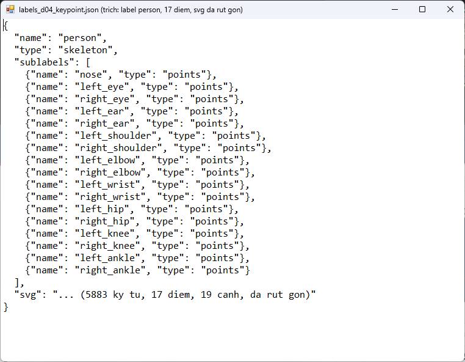
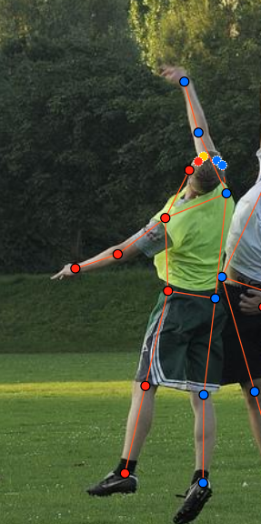
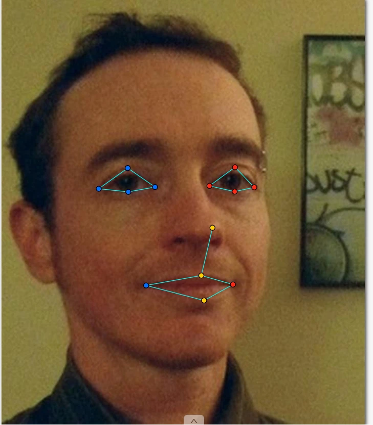
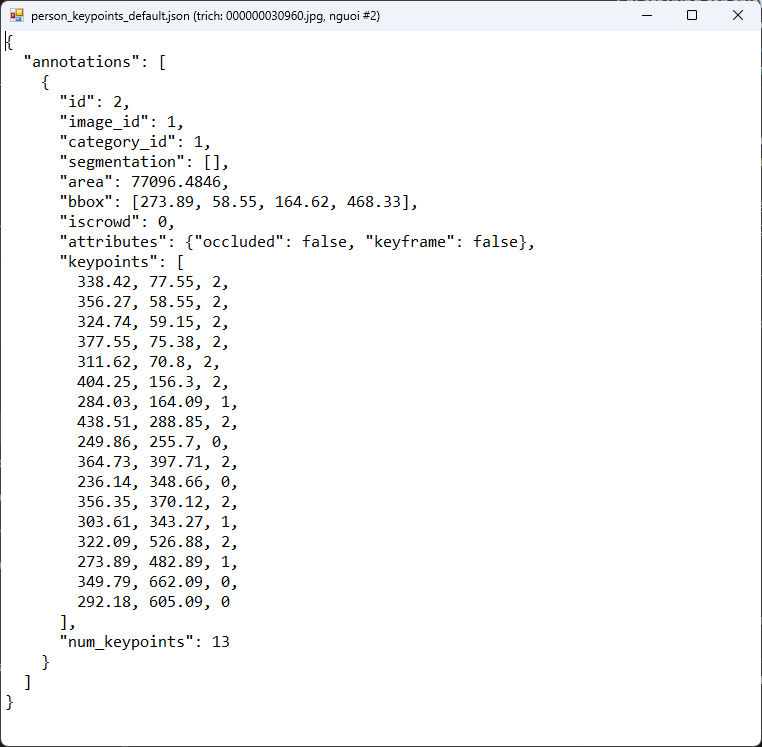

# Báo cáo cá nhân — NguyenVanTho-2A202603299

Đổi tên file theo quy tắc `MSSV_HoTen.md`. Ví dụ: `20241234_NguyenVanAn.md`.

Dữ liệu: 12 ảnh người COCO val2017 (Lin et al., 2014) và 8 ảnh chân dung Wikimedia Commons, chỉ dùng trong lớp.

## 0. Thông tin học viên

- Họ tên: Nguyễn Văn Thọ
- MSSV: 2A202603299
- Email: thonguyen28.nitc@gmail.com
- Link repository: https://github.com/NguyenVanTho2805/K5-L2B-DAY04-NguyenVanTho-2A202603299-KeypointPose-Student
- Phiên bản CVAT (Help → About): 2.74.1
- Máy: hệ điều hành Windows 11 Home · RAM 15,7 GB · chạy CVAT chế độ đầy đủ
- Bộ ảnh (`src/exports/assignment.json` do `lab.py setup` tạo): có
- Giờ bắt đầu:
- Giờ kết thúc:

## 1. Kiểm tra label (CP0)

| Label | Kiểu | Số điểm | Tên điểm đúng bảng của lab? | Đúng thứ tự? | Số cạnh |
|---|---|---:|---|---|---:|
| `person` | Skeleton | 17 | Đúng | Đúng | 19 |
| `face` | Skeleton | 13 | Đúng | Đúng | 13 |

Mẫu `person` dựng theo người quay mặt về camera (các điểm `left_*` nằm bên phải khung mẫu)? Có

Cách đổi cờ `occluded` / `outside` cho **một điểm** trên phiên bản CVAT này (một câu):

Rê chuột vào đúng điểm rồi bấm `Q` để bật `occluded` hoặc `O` để bật `outside` (bấm lại để tắt), hoặc bấm chuột phải vào điểm và chọn trong menu.

## 2. Số lượng đã gán và thời gian (CP1, CP2)

| Nhóm ảnh | Số ảnh | Số skeleton đã gán | Số người dưới 60 px (không gán) | Số poster / gương / màn hình bỏ qua | Thời gian (phút) |
|---|---:|---:|---:|---:|---:|
| `easy` | 5 | 5 | 0 | 0 | ~25 |
| `occluded` | 3 | 6 | 0 | 0 | ~21 |
| `back` | 2 | 3 | 0 | 0 | ~16 |
| `small` | 1 | 4 | ~4 | 0 | ~8 |
| `crowd` | 1 | 3 | 0 | 0 | ~14 |
| `faces` | 8 | 8 | — | 0 | ~24 |

- Số ảnh người đã xong ở mốc phút 105: ~8 / 10 (ước lượng theo nhịp trung bình của lịch lab, không đo thực tế)
- Thời gian (phút): CP1 ~84 · CP2 ~24 · CP3 ~20 (ước lượng theo nhịp trung bình của lịch lab, không đo thực tế)
- Ảnh tốn thời gian nhất là ảnh nào, vì sao?

Ảnh cuối của job là `000000572411.jpg` (nhóm `small`). Ảnh bị mờ và người bị che gần hết, nên các điểm keypoint rất khó đoán vị trí và khó vẽ.

## 3. Bảng ca khó (CP1, CP2)

Mỗi điểm bạn phân vân một dòng, nhất là phân vân giữa `v = 1` và `v = 0`, hoặc không chắc hướng người.

| Ảnh | Người / mặt | Điểm | Cờ đã chọn | Phân vân giữa | Lý do chọn |
|---|---|---|---:|---|---|
| `000000210604.jpg` | người #1 | `right_ear` | `v = 1` (occluded) | `v = 1` hay `v = 0` | Chọn `v = 1` vì có thể xác định tương đối vị trí các điểm đó. |
| `000000210604.jpg` | người #2 | `nose`, `left_eye`, `right_eye`, `right_ear` | `v = 1` (occluded) | `v = 1` hay `v = 0` | Chọn `v = 1` vì có thể xác định tương đối vị trí mắt sẽ nằm ở đó. |
| `000000220045.jpg` | người #1 | `right_eye`, `right_ear`, `right_elbow`, `right_wrist` | `v = 1` (occluded) | `v = 1` hay `v = 0` | Chọn `v = 1` vì có thể xác định tương đối vị trí các điểm đó. |
| `000000220045.jpg` | người #2 | `right_eye`, `right_ear`, `left_shoulder`, `right_shoulder`, `right_elbow`, `left_wrist`, `right_wrist`, `right_knee` | `v = 1` (occluded) | `v = 1` hay `v = 0` | Chọn `v = 1` vì có thể xác định tương đối vị trí các điểm đó. |
| `000000179201.jpg` | người #1 | `left_hip`, `right_hip` | `v = 1` (occluded) | `v = 1` hay `v = 0` | Chọn `v = 1` vì có thể xác định tương đối vị trí các điểm đó. |
| `000000179201.jpg` | người #1 | `left_knee`, `right_knee`, `left_ankle`, `right_ankle` | `v = 0` (outside) | `v = 0` hay `v = 1` | Chọn `v = 0` vì không thể xác định được vị trí các điểm đó. |
| `000000332273.jpg` | người #1 | `left_ear`, `right_ear` | `v = 1` (occluded) | `v = 1` hay `v = 0` | Chọn `v = 1` vì có thể xác định tương đối vị trí các điểm đó. |
| `000000332273.jpg` | người #1 | `nose`, `left_eye`, `right_eye` | `v = 0` (outside) | `v = 0` hay `v = 1` | Chọn `v = 0` vì không thể xác định được vị trí các điểm đó. |
| `000000332273.jpg` | người #2 | `left_knee`, `right_knee`, `left_ankle`, `right_ankle` | `v = 1` (occluded) | `v = 1` hay `v = 0` | Chọn `v = 1` vì có thể xác định tương đối vị trí các điểm đó. |
| `000000332273.jpg` | người #3 | `right_ear` | `v = 1` (occluded) | `v = 1` hay `v = 0` | Chọn `v = 1` vì có thể xác định tương đối vị trí các điểm đó. |
| `000000332273.jpg` | người #3 | `right_elbow`, `right_wrist` | `v = 0` (outside) | `v = 0` hay `v = 1` | Chọn `v = 0` vì không thể xác định được vị trí các điểm đó. |

## 4. Bảng tự review (CP3)

Đi từ ảnh cuối về ảnh đầu. 5 ảnh người (ít nhất 2 ảnh `back` hoặc `crowd`) và 3 ảnh mặt. Ít nhất 8 dòng, kể cả dòng `ok`. Ghi lỗi trước, sửa sau.

Mã lỗi dùng đúng một trong: `lr_swap`, `vis_flag`, `position`, `missing`, `extra`, `ok`.

| Ảnh | Người / mặt | Điểm | Mã lỗi | Ghi chú | Đã sửa? |
|---|---|---|---|---|---|
| `000000572411.jpg` | người #1 | toàn bộ skeleton | `extra` | Người cao 29 px, dưới 60 px nên không được gán | Chưa |
| `000000572411.jpg` | người #2 | toàn bộ skeleton | `extra` | Người cao 30 px, dưới 60 px nên không được gán | Chưa |
| `000000572411.jpg` | người #4 | `left_wrist`, `right_wrist` | `ok` | Script cảnh báo cặp cổ tay nằm ngược phía; đã kiểm tra lại, đúng trái/phải, giữ nguyên | Không cần |
| `000000359340.jpg` | người đứng phía sau (góc trên bên phải) | toàn bộ skeleton | `missing` | Chưa gán người đứng sau, lộ đầu và vai, cao từ 60 px | Chưa |
| `000000332273.jpg` | người #3 | `left_ankle`, `right_ankle` | `ok` | Script cảnh báo cặp cổ chân nằm ngược phía; đã kiểm tra lại, đúng trái/phải, giữ nguyên | Không cần |
| `000000332273.jpg` | người #1 | `left_ear`, `right_ear` | `ok` | Script cảnh báo cặp tai nằm ngược phía; đã kiểm tra lại, đúng trái/phải, giữ nguyên | Không cần |
| `000000308257.jpg` | người #1 | `left_ankle`, `right_ankle` | `ok` | Script cảnh báo cặp cổ chân nằm ngược phía; đã kiểm tra lại, đúng trái/phải, giữ nguyên | Không cần |
| `000000220045.jpg` | người #2 | `left_wrist`, `right_wrist` | `ok` | Script cảnh báo cặp cổ tay nằm ngược phía; đã kiểm tra lại, đúng trái/phải, giữ nguyên | Không cần |
| `face_99874.jpg` | mặt #1 | toàn bộ 13 điểm | `ok` | Ảnh kính râm: 8 điểm mắt sau tròng kính đặt `occluded`; đã xem lại, không có lỗi | Không cần |
| `face_469647.jpg` | mặt #1 | toàn bộ 13 điểm | `ok` | Mặt thẳng: `right_eye_outer` và `right_eye_upper` đặt `occluded`; đã xem lại, không có lỗi | Không cần |
| `face_137371.jpg` | mặt #1 | toàn bộ 13 điểm | `ok` | Mặt nghiêng; đã xem lại, không có lỗi | Không cần |

Tổng hợp số lỗi theo mã:

| `lr_swap` | `vis_flag` | `position` | `missing` | `extra` | `ok` |
|---:|---:|---:|---:|---:|---:|
| 0 | 0 | 0 | 1 | 2 | 8 |

Điểm còn phân vân giữa `v = 1` và `v = 0` (ghi cả hai lựa chọn và lý do chọn). Hai ví dụ, chi tiết các điểm khác xem mục 3:

- `000000332273.jpg`, người #1, `left_ear` và `right_ear`: phân vân giữa `v = 1` và `v = 0`. Chọn `v = 1` vì có thể xác định tương đối vị trí các điểm đó.
- `000000332273.jpg`, người #3, `right_elbow` và `right_wrist`: phân vân giữa `v = 0` và `v = 1`. Chọn `v = 0` vì không thể xác định được vị trí các điểm đó.

## 5. Kiểm file xuất và kết quả tự kiểm (CP4)

Tự kiểm tay trong file JSON:

| File | Người / mặt kiểm (ảnh, thứ tự) | Số phần tử `keypoints` | Điểm `outside` ra `v = 0`, `occluded` ra `v = 1`? | `num_keypoints` khớp? |
|---|---|---:|---|---|
| `NguyenVanTho_persons.zip` | `000000030960.jpg`, người #2 | 51 | Có: `right_elbow` (outside) ra `v = 0`, `right_shoulder` (occluded) ra `v = 1` | Có: `num_keypoints` = 13, bằng số điểm `v > 0` |
| `NguyenVanTho_persons.zip` | `000000463932.jpg`, người #1 | 51 | Có: `right_ear` (outside) ra `v = 0`, `right_eye` (occluded) ra `v = 1` | Có: `num_keypoints` = 16, bằng số điểm `v > 0` |
| `NguyenVanTho_faces.zip` | `face_99874.jpg`, mặt #1 | 39 | Có: 8 điểm mắt (occluded) ra `v = 1`; mặt này không có điểm `v = 0` | Có: `num_keypoints` = 13, bằng số điểm `v > 0` |

Sau khi xuất, CVAT ghi `occluded` thành `v = 1` và `outside` thành `v = 0`. Tọa độ của điểm `outside` trong file là `0, 0` hay tọa độ cũ? Tọa độ cũ (ví dụ `right_elbow` của `000000030960.jpg` người #2 là `249.86, 255.7, 0`).

Hai job đã chuyển sang completed trên CVAT? Có

Dán phần **TÓM TẮT** in ra từ `src/check_submission.py`:

```text
----- TÓM TẮT (dán vào báo cáo mục 5) -----
- File person: NguyenVanTho_persons.zip
  Số ảnh: 12 · số skeleton `person`: 21 · mỗi annotation 51 số
  Skeleton theo ảnh: 000000030960=2, 000000177889=1, 000000179201=2, 000000184224=1, 000000196283=1, 000000210604=2, 000000220045=2, 000000308257=1, 000000332273=3, 000000359340=1, 000000463932=1, 000000572411=4
  Cờ v: v=2 276 (77%) · v=1 51 (14%) · v=0 30 (8%)
  num_keypoints trung bình: 15.6
- File face: NguyenVanTho_faces.zip
  Số ảnh: 8 · số skeleton `face`: 8 · mỗi annotation 39 số
  Skeleton theo ảnh: face_125051=1, face_137371=1, face_196742=1, face_261458=1, face_469647=1, face_490361=1, face_505385=1, face_99874=1
  Cờ v: v=2 94 (90%) · v=1 10 (10%) · v=0 0 (0%)
  num_keypoints trung bình: 13.0
- Ghi chú: 30 điểm v = 0 vẫn mang tọa độ cũ (CVAT 2.x xuất như vậy; chuẩn COCO ghi 0, 0). Không phải lỗi: điểm v = 0 bị bỏ qua khi huấn luyện và khi chấm.
- Số [LỖI]: 0 · số [CẢNH BÁO]: 8
Kết quả: ĐẠT (đọc lại từng cảnh báo ở trên)
```

Các `[CẢNH BÁO]` còn giữ nguyên và lý do:

- `000000220045.jpg` người #2, cặp cổ tay nằm ngược phía. Lý do: đã kiểm tra lại, trái/phải đúng; tôi xác định được tương đối vị trí các điểm này nên giữ nguyên.
- `000000308257.jpg` người #1, cặp cổ chân nằm ngược phía. Lý do: đã kiểm tra lại, trái/phải đúng; tôi xác định được tương đối vị trí các điểm này nên giữ nguyên.
- `000000332273.jpg` người #1, cặp tai nằm ngược phía. Lý do: đã kiểm tra lại, trái/phải đúng; tôi xác định được tương đối vị trí các điểm này nên giữ nguyên.
- `000000332273.jpg` người #3, cặp cổ chân nằm ngược phía. Lý do: đã kiểm tra lại, trái/phải đúng; tôi xác định được tương đối vị trí các điểm này nên giữ nguyên.
- `000000572411.jpg` người #1, cao 29 px (dưới 60 px). Lý do: đây là lỗi `extra` (xem mục 4), tôi chưa sửa.
- `000000572411.jpg` người #1 và #4, cặp cổ tay nằm ngược phía. Lý do: đã kiểm tra lại, trái/phải đúng; tôi xác định được tương đối vị trí các điểm này nên giữ nguyên.
- `000000572411.jpg` người #2, cao 30 px (dưới 60 px). Lý do: đây là lỗi `extra` (xem mục 4), tôi chưa sửa.

## 6. Ảnh chụp màn hình

1. Label `person` trong label constructor (đủ 17 điểm có tên):

   

2. Một người quay lưng đã gán, cờ đã đặt:

   

3. Một khuôn mặt đã gán 13 điểm, phóng to vùng mắt:

   

4. Một đoạn JSON xuất của một người:

   

Nguồn ảnh: COCO val2017 / Wikimedia Commons.

## 7. Tự đánh giá

1. Lỗi bạn mắc nhiều nhất hôm nay, và cách bạn sẽ tránh ở dự án thật:

   Lỗi tôi mắc nhiều nhất hôm nay là nối sai keypoint, gồm ba kiểu: đặt điểm lệch khỏi tâm khớp, đổi nhầm trái/phải, và đặt nhầm điểm này vào chỗ điểm khác. Ngoài ra là đặt sai cờ, ví dụ để `v = 2` chỗ đáng lẽ `v = 1`, hoặc ngược lại.

   Cách tránh ở dự án thật: xác định kỹ vị trí các điểm, và có thể ẩn keypoint của những người đã label xong để dễ nhìn hơn.

2. Một quy tắc bạn đề xuất thêm vào guideline (kèm ảnh ví dụ nếu có):

   Không có.

3. Nhãn của bạn đi vào model ở đâu? Chọn một lỗi bạn đã sửa và nói nó sẽ làm model học sai thế nào (heatmap, trọng số trong loss, hay bước lật ảnh):

   Lỗi tôi chọn: đặt sai cờ, để `v = 0` chỗ đáng lẽ `v = 1`, hoặc ngược lại.

   Lỗi này đi vào model ở: trọng số trong loss, vì điểm `v = 1` có trọng số 1 còn điểm `v = 0` có trọng số 0.

   Model sẽ học sai: nếu tôi để `v = 1` cho điểm đáng lẽ là `v = 0`, điểm đó có trọng số 1 nên model bị phạt nếu đoán khác vị trí tôi đặt, tức là học theo một vị trí sai như thể nó đúng, và khi chấm OKS điểm này cũng được tính như điểm thật. Ngược lại, nếu tôi để `v = 0` cho điểm đáng lẽ là `v = 1`, điểm đó có trọng số 0 nên model bỏ qua nó và mất một điểm học đúng ở khớp bị che.

## 8. Khó khăn và lỗi kỹ thuật

Không có.

## Bonus (nếu làm)

### B1 — 3 ảnh người khó thêm

| Ảnh | Số skeleton | Số người dưới 60 px | Ca khó nhất |
|---|---:|---:|---|
| | | | |
| | | | |
| | | | |

Kết quả `src/check_submission.py` cho `HoVaTen_bonus_persons.zip`:

```text
(dán ở đây)
```

### B2 — 5 ảnh khuôn mặt đen trắng / hồng ngoại

Ảnh không màu khó hơn ở điểm nào? Kính râm trên ảnh hồng ngoại có còn là `v = 1` không?

...

### B3 — Model so với nhãn của tôi (không tính điểm)

- Demo đã dùng:
- Ảnh đã thử:

1. Model có trả điểm cho khớp bị che, hay khớp ngoài ảnh không? Confidence ở các điểm đó thế nào?

   ...

2. Với người quay lưng, model có đổi trái/phải không?

   ...

3. Bộ điểm của model có giống 17 điểm COCO không?

   ...

## 9. Tài liệu tham khảo và công cụ AI đã dùng

- Tài liệu của lab (repo đề bài): `README.md`, `RULES.md`, `RUBRIC.md`, `CHECKPOINTS.md`, `SUBMISSION.md`, `docs/GUIDELINE.md`, `docs/CVAT_CHEATSHEET.md`, `docs/COCO_KEYPOINTS.md`, `docs/HUONG_DAN_BANG_HINH.md`.
- Dữ liệu ảnh: COCO 2017 (Lin et al., 2014).
- Công cụ AI: Claude (Claude Code). Dùng để đọc và tóm tắt tài liệu lab, giải thích quy ước nhãn và cách dùng CVAT, chạy `src/check_submission.py`, góp ý chỗ nên kiểm lại khi tôi gửi ảnh chụp màn hình nhãn, chép file xuất vào `src/exports/`, điền các phần thông tin kỹ thuật (mục 0, 1, 5) từ file xuất, và tạo ảnh `4_json_export.png` (cửa sổ văn bản hiển thị đoạn JSON lấy nguyên từ file `NguyenVanTho_persons.zip`, đã xuống dòng cho dễ đọc, rồi chụp màn hình). Không dùng để sinh điểm. Mục 4 và mục 7 do tôi viết; riêng mục 7 câu 3, các ý về trọng số trong loss tôi tham khảo từ gợi ý của Claude rồi diễn đạt lại. Ở mục 3, các cột ảnh, người, điểm và cờ được điền từ file xuất; hai cột "Phân vân giữa" và "Lý do chọn" do tôi tự viết.
